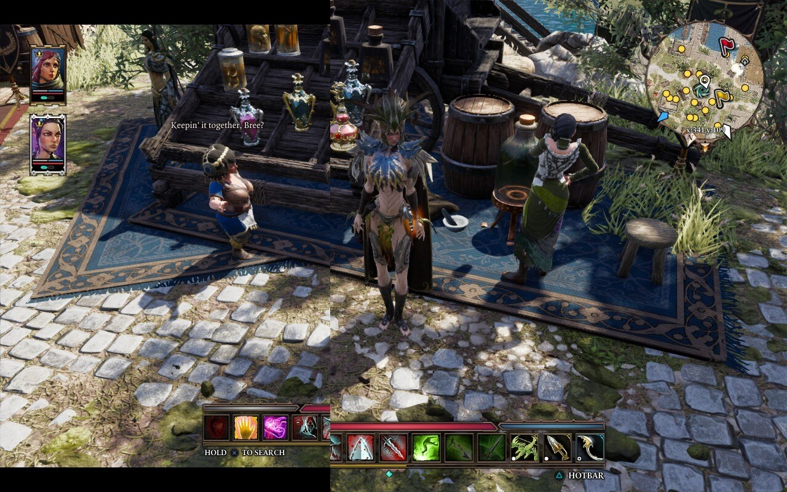

# Divinity: Original Sin 2 16:10 patch

This patch removes letterboxing (black bars) on 16:10 resolution without stretching.
It is intended for handheld consoles like Steam Deck and Legion Go S, but works on any 16:10 screen.

Supported game version: 3.6.117.3735 (latest as of 1/29/2026) Steam/GOG, verified on SteamOS 3.7.19.

**Installation (Steam Deck):**
- [Download](https://github.com/psykana/dos2deck/releases/latest) latest release
- [Transfer](https://www.youtube.com/watch?v=VfsSCMiZVf4) d3d11.dll to `.../Divinity Original Sin 2/DefEd/bin`
- Launch the game, set resolution to 1280x800

**Known issues:**
* Main menu art is cropped, since it was drawn for 16:9.
* Other aspect ratios like 4:3 and 5:4 are not supported.

Reach out on [Larian Studios discord](https://discord.com/invite/larianstudios) server.

**Credits:**
* [Larian Studios](http://larian.com/), for [Divinity: Original Sin 2](http://store.steampowered.com/app/435150/Divinity_Original_Sin_2/)
* [Valve](https://www.valvesoftware.com/en/) for Steam Deck and Proton
* Norbyte, Pip and others at `#dos-modding` for info on game's engine inner workings.